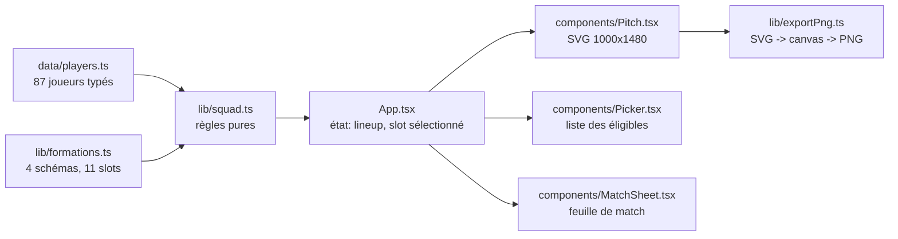

# Architecture

## Vue d'ensemble

Mon XI PSG est une application **strictement cliente** : un bundle statique, aucune requête réseau au
runtime, aucun état serveur. Toute la valeur produit tient dans une transformation locale :
un ensemble de choix (schéma + joueurs) → un onze valide → une image.



## Modèle d'état

```ts
type Lineup = Readonly<Record<string, string | null>>;
// { gk: 'donnarumma', lb: null, cb1: 'thiago-silva', ... }
```

Trois choix, et leurs raisons :

| Décision | Pourquoi |
| --- | --- |
| Clé = `slot.id`, valeur = `player.id` | L'échange et le déplacement sont des écritures en O(1), sans recherche d'index. |
| `null` = slot vide (pas `undefined`, pas clé absente) | `Object.keys(lineup)` reste la liste des 11 slots, `every()` suffit pour `isComplete`. |
| `Readonly` | Le state ne se mute pas en place : chaque mutation produit un objet neuf, exploitable par React. |

L'état vit dans `App.tsx` uniquement : `formationId`, `lineup`, `selectedSlotId`, `query`, `busy`,
`error`. Aucun état dupliqué dans les composants, aucun contexte, aucune librairie d'état — le
domaine est trop petit pour en justifier une.

## Les quatre règles métier

### 1. Éligibilité

```ts
isEligible(slot, player) = player.positions ∩ slot.accepts ≠ ∅
```

Un slot décrit les postes qu'il tolère (`accepts`), pas le poste du joueur. C'est ce qui permet à
Marquinhos (`CB`, `RB`) de couvrir les deux, et à un CB de ne **jamais** finir en pointe.

### 2. Placement (`place`)

`place(lineup, formation, slotId, playerId)` gère trois cas, dans cet ordre :

1. **Slot vide** → le joueur s'assoit.
2. **Joueur déjà titulaire ailleurs, occupant du slot cible compatible avec l'ancienne place** →
   échange des deux (chacun garde un poste valide).
3. **Joueur déjà titulaire ailleurs, occupant incompatible** → l'occupant sort du onze (retour au
   banc, il redevient sélectionnable) et l'ancien slot du joueur se libère.

Entrée invalide (slot inconnu, joueur inconnu, poste incompatible) → **le lineup est renvoyé
inchangé, par identité**. Aucune exception : un composant ne doit jamais avoir à se protéger.

> Cas piège couvert par un test : Marquinhos en `cb1`, Hakimi en `rb`, on place Marquinhos en `rb`.
> Hakimi n'a pas le poste `CB`, donc pas d'échange : Hakimi sort, `cb1` se libère.

### 3. Changement de schéma (`adaptLineup`)

Parcours les slots de la nouvelle formation dans l'ordre et y replace, un par un, les titulaires
encore libres dont un poste correspond. Conséquence assumée : un joueur sans slot compatible
**n'est pas conservé** (ex. un 4-3-3 complet passé en 4-4-2 perd un attaquant). On ne perd jamais
silencieusement un joueur compatible, et jamais on ne duplique un joueur.

### 4. Complétude

`filledCount` compte les valeurs non `null` ; `isComplete` vérifie que **les 11** slots sont remplis.
Le compteur de progression, le message de fin et le bouton d'export s'appuient dessus — l'export reste possible à 10/11
(choix produit : une image partielle est parfois ce qu'on veut).

## Pipeline d'export PNG

`lib/exportPng.ts` n'utilise **aucune librairie** (pas de html2canvas, pas de puppeteer) :

```
SVG du DOM
  → cloneNode(true)
  → xmlns + width/height explicites
  → XMLSerializer → Blob image/svg+xml
  → URL.createObjectURL → new Image() (onload)
  → canvas 2× (2000 × 2960)
  → canvas.toBlob('image/png')
  → <a download> cliqué programmatiquement
```

Deux contraintes en découlent, et elles expliquent la moitié du code de `Pitch.tsx` :

- **La feuille de style de l'app ne s'applique pas dans l'image.** Tout ce qui doit apparaître dans
  le PNG est en attributs de présentation (`fill`, `stroke`, `font-family`, `font-size`).
- **Les polices doivent être système** (`system-ui, -apple-system, Segoe UI, sans-serif`) : une police
  téléchargée ne serait pas disponible dans le contexte de l'image.

### Portraits : pourquoi des data URL

Une image SVG chargée via `` est un document *statique* : elle **ne charge aucune
ressource externe**. Une `<image href="https://…">` s'afficherait à l'écran mais serait absente du
PNG. Les portraits sont donc convertis en data URL (`lib/photos.ts` : `fetch` → `blob` →
`FileReader`) avant le rendu, et le SVG cloné reste autonome.

Conséquences :

- la source distante doit envoyer `Access-Control-Allow-Origin` (le CDN API-Sports envoie `*`) ;
  sans CORS, le `fetch` échoue et le monogramme reste — jamais d'image cassée ;
- un cache mémoire (`Map`) évite de re-télécharger un portrait déjà chargé ;
- toute image ajoutée au terrain doit passer par ce mécanisme, sinon l'export ment sur ce que
  montre l'écran.

Le rendu à l'écran et le PNG sortent donc du même arbre SVG : ce que tu vois est ce que tu exportes,
sans second chemin de rendu à maintenir.

## Décisions techniques (et ce qu'on a écarté)

| Décision | Alternative écartée | Raison |
| --- | --- | --- |
| Vite + React | Next.js | Aucun besoin de SSR/SSG : 100 % client, un seul écran. Next aurait ajouté routing et conventions serveur sans bénéfice. |
| Données statiques typées | API / scraping | 2 h de budget, zéro clé, zéro panne. Une fiche fausse se corrige en une ligne. |
| Logique pure dans `lib/` | hooks `useMemo` dans les composants | Testable sans DOM, et le composant reste remplaçable. |
| SVG | Canvas pour le terrain | Le SVG est du DOM : sélectionnable, accessible, et directement sérialisable pour l'export. |
| CSS variables + CSS simple | Tailwind / CSS-in-JS | Deux fichiers, aucun build step supplémentaire, aucun couplage. |
| `place()` silencieux | `throw` + try/catch UI | Un mutateur qui lève oblige chaque appelant à se protéger ; ici l'invalidité est un état normal (poste incompatible). |

## Contrat des fichiers

| Fichier | Responsabilité | Ne doit pas |
| --- | --- | --- |
| `data/players.ts` | données + libellés (`eraLabel`, `shortName`) | contenir de règle de jeu |
| `lib/formations.ts` | schémas, slots, `accepts`, coordonnées | connaître les joueurs |
| `lib/squad.ts` | état du onze, éligibilité, placement | toucher au DOM |
| `lib/exportPng.ts` | conversion et téléchargement | connaître le contenu du terrain |
| `components/Pitch.tsx` | rendu du terrain et des cartes | décider d'un placement |
| `components/Picker.tsx` | filtrer/afficher les éligibles | modifier le lineup directement |
| `components/MatchSheet.tsx` | afficher les slots par ligne et la progression | regrouper les slots lui-même (`slotsByLine` vit dans `lib/formations.ts`) |
| `App.tsx` | orchestration, état, handlers | calculer une règle métier |

## Limites connues

- **Pas de persistance** : un rafraîchissement perd la compo (pas de `localStorage`, pas d'URL).
- **Pas de partage** : aucune sérialisation de l'état dans l'URL.
- **Pas de rendu serveur** : l'aperçu social (Open Graph) est statique.
- **Données manuelles** : 87 fiches, aucune garantie d'exhaustivité, aucune source automatique.
- **Pas de gestion d'erreur de rendu** : pas d'ErrorBoundary ; une exception dans un composant vide
  l'écran. À ajouter si des fonctionnalités dynamiques arrivent.
